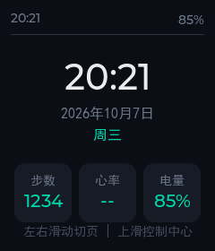
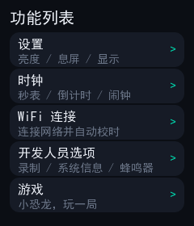
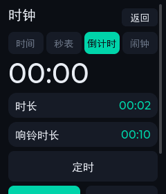
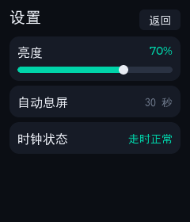
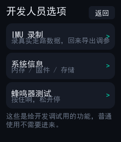
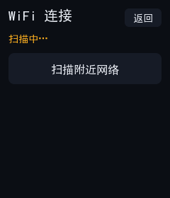
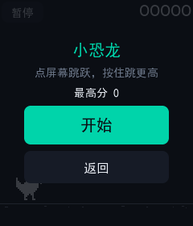
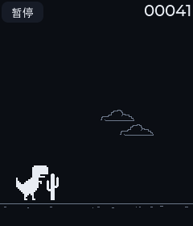
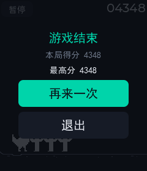

# AI 智能手表（ESP32-S3）

> 一块自己从零写起来的触摸智能手表：**表盘 / 计步 / 时钟 / WiFi 校时 / 小游戏**，
> 全部跑在 240×280 的圆角屏上。下一步是叠加 AI 语音，变成"能用嘴指挥的手表"。

**当前固件版本：`v0.6.1`**（2026-10-08）　｜　**状态：P1（普通智能手表）全部达成；A 批（缺陷修复 + 性能配置）已完成**

| 时间页 | 功能列表（5 行一屏放下） | 时钟 · 倒计时 |
|---|---|---|
|  |  |  |
| **设置** | **开发人员选项** | **WiFi 连接** |
|  |  |  |
| **小恐龙 · 开始** | **小恐龙 · 游戏中** | **小恐龙 · 结束** |
|  |  |  |

> 截图是**PC 模拟器**跑出来的 —— 和实机是**同一份界面源码**（见第四节）。
> 9 张图合计 33KB（64 色调色板压缩），跟着仓库一起版本管理。
> （v0.6.1 起"功能列表"5 行一屏放下、不再滚动，原来那张"未滑动时"的图已无意义，已删。）

---

## 一、这块表现在能干什么

| 页面 | 功能 |
|---|---|
| **时间** | 大号时钟 + 日期 + 星期 + 电量 + 步数；时间未校准时明确显示"未校准" |
| **运动** | 步数 / 距离（距离 = 步数 × 0.5m，一眼能验算） |
| **健康** | 占位页（等外接 MAX30102 后填心率/血氧，界面已按最终形态做好） |
| **功能列表** | 设置 / 时钟 / WiFi 连接 / 开发人员选项 / **游戏**（**5 行一屏放下**，v0.6.1 起不再需要滑动） |

**子页面**

* **设置**：亮度、自动息屏、时钟状态
* **时钟**：时间 / 秒表 / 倒计时 / 闹钟（4 个标签）
  * 秒表和倒计时**离开页面也继续走**（时钟服务是常驻的）
  * 倒计时/闹钟到点在**任何页面都会响**并弹出提示层
  * 自定义时长用 iOS 风格滚轮选择器
* **WiFi 连接**：扫描 → 手写小键盘输密码 → 连接 → 自动 SNTP 校时
  * 用已保存的密码连不上时**自动清除该凭据**并说明原因（避免路由器改密码后卡死）
* **开发人员选项**：IMU 数据录制、系统信息、蜂鸣器测试、手动校时
* **游戏**：游戏列表 → **谷歌小恐龙**（点屏幕跳、按住跳更高、最高分存 NVS、
  左上角暂停菜单、闹钟到点自动暂停、玩游戏期间不自动息屏）

**全局交互**

* 左右滑动切页（跟手 + 吸附 + 橡皮筋）
* 上滑打开控制中心（时间 / 电量 / 亮度滑块）
* 息屏省电（只关背光；熄灭后第一下触摸只负责亮屏，不会误触）
* 串口命令行（20 条）：`time` / `set_time` / `battery` / `brightness` / `settings` /
  `status` / `motion` / `motion_watch` / `steps_reset` / `rec`（IMU 录制）/ `imu_raw` /
  `next` / `pages` / `wifi` / `power` / `reset_settings` /
  **`taskmem`（各任务栈余量）/ `stats`（各任务 CPU）/ `bt`（所有任务调用栈）/
  `crash`（故意崩溃，验证 coredump）**（见 `components/app/app_console.c`）
* **崩溃可查现场**（v0.6.1）：固件带 coredump 分区，设备崩了之后
  在 PC 上跑 `idf.py coredump-info` 就能看到**出错任务 + 带源码行号的调用栈**

---

## 二、硬件

| 项 | 参数 |
|---|---|
| 开发板 | **Waveshare ESP32-S3-Touch-LCD-1.69**（V2.1） |
| SoC | ESP32-S3R8：双核 240MHz，**8MB Octal PSRAM**，**16MB Flash** |
| 屏幕 | 1.69" IPS **240×280**，ST7789V2（4 线 SPI @40MHz） |
| 触摸 | CST816T（I²C 0x15） |
| IMU | QMI8658C（I²C 0x6B）—— 计步用 |
| RTC | PCF85063ATL（I²C 0x51）—— ⚠️ **板子没有备份电池，掉电就丢**，靠 WiFi 校时兜底 |
| 蜂鸣器 | GPIO42（PWM 单音，不是喇叭） |
| 电池 | B+ 经 200K/100K 分压到 GPIO1 采样 |
| 空闲扩展口 | GPIO 2 / 3 / 17 / 18 |

> 全工程的 GPIO 号和 I²C 地址**只写在 `components/board/include/board.h` 一个文件里**，
> 换板子只改它 + `bsp.c`，驱动/服务/界面一行不动。

---

## 三、技术栈与工程结构

```
软件：ESP-IDF v5.5.4  +  LVGL 8.4  +  FreeRTOS
依赖：全部本地化在 components/ 里（关掉了组件管理器，断网也能编译）
UI  ：手写 LVGL，没有用 SquareLine / EEZ Studio
```

```
firmware/smartwatch/            ← git 仓库根目录
├── build.ps1                   # 一条命令构建 / 烧录 / 监视（PowerShell）
├── sdkconfig.defaults          # 默认配置（芯片 / Flash / PSRAM / LVGL）
├── partitions.csv
├── main/                       # 入口
├── components/                 # ★ 22 个组件
│   ├── board/                  #   全工程唯一知道 GPIO 号的地方
│   ├── bsp/                    #   屏幕 / 触摸 / 背光 / LVGL 移植
│   ├── ui_port/                #   UI 平台端口（实机版 / PC 版各一个实现）
│   ├── watch_ui/               #   ★ 界面框架：主题/控件/轮播/手势/模态/控制中心
│   │                           #     时钟服务、到点提醒层、2bpp 画布、游戏宿主
│   ├── watch_ui_pages/         #   ★ 具体页面 + 游戏本体（含生成的精灵位图）
│   ├── fonts/                  #   生成的中文字库（14/16/20px）
│   ├── data_hub/               #   ★ 设备状态唯一真源（UI 只读它）
│   ├── motion/ imu/ rtc_pcf85063/ battery/ buzzer/ power/
│   ├── settings/               #   所有可持久化配置（NVS）
│   ├── wifi_service/           #   WiFi + SNTP + 凭据自愈
│   ├── imu_logger/             #   IMU 录制（存 flash，可导出到电脑）
│   ├── event_bus/ app/
│   └── lvgl/ esp_lvgl_port/ esp_lcd_touch*/   # 本地化的第三方组件
├── doc/                        # ★ 文档（见第七节）
└── tools/                      # ★ 开发工具（字库/校验/精灵/串口/计步调参）
```

**四条设计约束（都不是"最佳实践"，是被坑出来的）**

| 约束 | 为什么 |
|---|---|
| `board.h` 独占引脚定义 | 换板子只改一处；驱动层不许出现 `GPIO_NUM_x` |
| `data_hub` 是设备状态唯一真源 | UI 只读快照，不直接碰驱动；采样任务和 UI 解耦 |
| **界面层零 ESP-IDF 依赖** | 界面代码要能在 PC 上原样跑（见下节） |
| 中文字面量集中登记 + 脚本校验 | 中文是"按需抽字"的，漏一个字就是豆腐块 |

---

## 四、怎么做到"不烧板子就能改界面"

这是这个项目里**最省时间的一件事**：

```
实机：main.c → app.c → watch_ui + watch_ui_pages        （界面）
PC  ：sim_main.c → ui_port_pc + sim_data + watch_ui + watch_ui_pages
                                  ↑ 同一份源码
```

* 界面层不许 include 任何 ESP-IDF 头文件；需要"平台能力"（亮度/设置/WiFi/
  蜂鸣器/时间/息屏）时，走 `watch_platform.h` 里的**函数指针钩子**，由 `app.c` 注入实机实现。
* `lvgl_sim/`（仓库外）用 MinGW 把它编成 Windows 程序，改完几秒就能看到效果，
  **还能把每个页面截成 PNG**。

### 为什么截图这件事很重要

v0.5.0 在实机上遇到"时钟页部分中文变成矩形""标签栏只有一个按钮"，
而**所有静态检查（字库脚本、编译、逻辑自检）全部通过** ——
这类问题只有看画面才发现得了。所以模拟器加了截图能力，
现在每个页面/标签/弹窗都会自动截图，人工核对。

### 模拟器自检

```powershell
cd lvgl_sim
mingw32-make -j8
$env:SIM_SELFTEST="1"; .\lvgl_sim.exe     # 退出码 = 失败项数（0 = 全过）
```

三段自检，当前 **0 项失败**：

| 段 | 覆盖 |
|---|---|
| 轮播 | 换页/吸附/偏移归零 |
| 时钟 + 子页面 | 秒表精度（对墙钟）、暂停、倒计时到点、闹钟、提醒层、滚轮、各子页构建 |
| **游戏** | 功能列表可滚、画布真的在画（数像素）、跳跃手感、**机器玩家连跑 132 秒不死**、碰撞、最高分存档、暂停冻结、闹钟自动暂停、退出不漏对象/定时器、第二次打开、**滑动不误触** |

其中"机器玩家"是这一版最有用的自检：它用**和人类一样的打法**（固定提前量起跳 +
按住 0.4 秒）跑两分钟，用来验证难度参数是**人类可玩**的 —— 第一版的物理参数
数学上就跳不过去，人肉试玩只会觉得"这游戏好难"。

---

## 五、怎么编译和烧录

**前置**：ESP-IDF v5.5.4（`IDF_PATH` 已配）、MinGW（可选，只给模拟器用）。

```powershell
cd firmware/smartwatch

.\build.ps1 build                 # 编译
.\build.ps1 flash -Port COM24     # 编译 + 烧录（端口换成你的）
.\build.ps1 monitor               # 串口监视（115200）
.\build.ps1 clean                 # 清理（改了 sdkconfig.defaults 必须 clean！）
.\build.ps1 menuconfig
```

> PowerShell 执行策略可能拦脚本，用：
> `powershell -NoProfile -ExecutionPolicy Bypass -File .\build.ps1 build`
>
> ⚠️ 两个必须知道的点：
> 1. **改了 `sdkconfig.defaults` 一定要 `clean`** —— 否则新配置不生效（踩过）。
> 2. 这块板子的串口走 **USB-Serial-JTAG**（不是 UART0，UART0 没接到 Type-C 口）。

### 改了中文之后必做（否则屏幕上就是豆腐块）

```powershell
.\tools\gen_font.ps1 -Force                    # 不带 -Force 会静默跳过！
python tools\check_all_literals.py             # 界面里出现的汉字都在字库里？
python tools\check_fonts.py                    # 没有"ASCII 字体 + 中文文案"？
python tools\check_glyphs.py --all
```

### 每次改动的固定流程

```
1. 改代码
2. 加中文了？-> gen_font.ps1 -Force + 三个 check 脚本
3. mingw32-make -j8 && SIM_SELFTEST=1 lvgl_sim.exe   （逻辑 + 截图）
4. 看截图（豆腐块 / 控件被挤 / 错位，只有画面能发现）
5. .\build.ps1 build                                  （固件编译）
6. 写 doc/version/vX.Y.Z.md，更新版本列表和三处版本号
7. 烧录 + 按清单实机验证（触摸手感 / 帧率 / 颜色只能人肉验）
```

---

## 六、几个实现上值得一提的地方

| 主题 | 做法 |
|---|---|
| **跟手滑动** | 三个页面槽并排放在一个容器里，拖动时实时改偏移、松手做吸附动画；子页面（WiFi/时钟/游戏）是**盖在上面的模态**，不参与滑动 |
| **游戏渲染** | `lv_canvas` + **2bpp 索引画布**（240×280 只占 16.8KB），直接按位写像素；每帧只让**下面那条会动的带子**失效（整屏刷新要 27ms，只有 37FPS 上限） |
| **游戏外壳** | 「宿主层」管全屏层/帧定时器/开始暂停结束面板/最高分/防息屏/闹钟联动，「游戏本体」只实现 9 个回调（init/reset/step/render/input/score/over/dirty_top/destroy）—— 加第二款游戏 = 写一个文件 + 注册一行 |
| **精灵图** | 用工具从参考工程的原版 2 倍图**隔点取样**折半成 1x（不能缩放，一缩放像素画就糊），输出 2bpp 位图 C 数组；工具会打印 ASCII 点阵和核对图 |
| **中文字库** | 完整中文字库（2 万多汉字 × 3 个字号）放不进 flash，所以**只抽取项目里实际用到的字**（当前 757 个码点 × 3 个字号），并用脚本强制"漏字必报错" |
| **时钟服务** | 秒表/倒计时/闹钟做成**常驻服务**（不是页面的一部分），否则离开页面就停；到点提醒是盖在最上层的全局层 |
| **WiFi 自愈** | 用已保存的密码连接失败（认证类原因）时**自动清除凭据**，并在界面上说明原因；"走出信号范围"这类失败**不删**（和密码无关） |

---

## 七、文档

| 文档 | 内容 |
|---|---|
| [`doc/开发交接文档-v3.md`](doc/开发交接文档-v3.md) | **⭐ 新人从这份开始**：5 分钟上手 / 架构铁律 / 子系统坑 / 调试手册 / 工作流 / 踩坑总表 / 交接清单（自包含，取代 v2） |
| [`doc/智能手表-对标参考工程开发指南.md`](doc/智能手表-对标参考工程开发指南.md) | **⭐ 怎么用那个同芯片开源工程干活**：差异清单（别照抄引脚/配置方式）/ 文件地图（想学什么去哪看）/ 对标方法论 + 搜索配方 / 三个现成实现范例（`wait_cb`、`bt <任务名>`…）/ 动手练习 |
| [`doc/智能手表-功能扩展对标与可行性分析.md`](doc/智能手表-功能扩展对标与可行性分析.md) | **下一步做什么**：对标主流手表找差距 + 42 项功能逐项可行性评判 + 扩展模块选型 + 路线图 |
| [`doc/智能手表-对标Watch-Player_IDF与优化清单.md`](doc/智能手表-对标Watch-Player_IDF与优化清单.md) | 与一个同芯片开源手表工程逐模块对标：**功能差距 + 代码级问题清单（P0~P3，带文件行号）** |
| [`doc/智能手表-项目计划.md`](doc/智能手表-项目计划.md) | 项目计划 + **逐项实际状态**（P1 达成情况、里程碑、验收、风险表） |
| [`doc/智能手表-A批实施文档.md`](doc/智能手表-A批实施文档.md) | v0.6.1 那批修复的**实施计划**（每项的做法/验证/回滚，含实机验收清单） |
| [`doc/version/README.md`](doc/version/README.md) | **版本改动记录索引**（v0.1.0 ~ v0.6.1） |
| [`doc/version/v0.6.1.md`](doc/version/v0.6.1.md) | 当前版本：12 项修复/配置 + **真机验证记录**（taskmem、coredump、WiFi 排查全过程） |
| [`doc/version/v0.6.0.md`](doc/version/v0.6.0.md) | 上一版：游戏功能 + 两个实测问题的根因分析 + 13 个坑 |
| [`doc/智能手表-实施文档.md`](doc/智能手表-实施文档.md) | 动手细节 + 早期踩的坑 |
| [`doc/QMI8658C-计步方案.md`](doc/QMI8658C-计步方案.md) | 计步寄存器表、定点算法推导、**调参流程** |

> 每个版本文档的最后一节都是「本版本改动简单说明」——一段话讲清这版干了什么。
>
> 另外，**项目根目录**（`firmware/` 的上一层，不在本仓库内）还有
> `开发交接文档-v2.md`、`代码架构说明.md`、`板载资源与功能能力分析.md` 等文档；
> 换机器时记得一起带上。

---

## 八、当前状态与已知限制

**已完成**：P1 的 14 项功能里 **13 项完成、1 项明确取消**（抬腕亮屏），M1~M6 里程碑达成；
另外做掉了 WiFi 校时、时钟（秒表/倒计时/闹钟）、游戏等计划外内容。

**已知限制**（都是明确知道的，不是没发现）：

| 限制 | 说明 |
|---|---|
| RTC 无备份电池 | 硬件的锅：断电就丢时间，靠 WiFi 校时 + 手动校时页兜底 |
| 计步只用过一组数据标定 | 实测 50 步→51 步（+2%）、静止 12 秒 0 误计；跨步频/跑步/上下楼还没验 |
| 功能列表行高偏紧凑 | v0.6.1 把行高从 52 收到 **43** 才让 5 行一屏放下（副标题字号 14 不好再降）；观感是否接受由使用者定 |
| WiFi 兼容性 | 遇到过某台路由器在**认证阶段完全不应答**（`reason=2`），实测为 **AP 侧行为**（同一时刻连别的 AP 一切正常）；本机侧已修掉"失败被误判成用户主动断开"的 bug（见 v0.6.1 §8.1/8.5） |
| 屏幕 SPI 仍 40MHz | 对标工程跑 80MHz，但微雪官方示例也是 40MHz —— 属**可选实验**，未做（改一行 `pclk_hz` 即可，需实机验证） |
| 游戏 | 只有一款；无音效（蜂鸣器是单音喇叭做不了）；无下蹲/难度选择 |
| 健康页 | 空占位，等外接 MAX30102 |
| 尚未做 | BLE 连手机（P2 唯一没做的大项）、AI 语音（P3）、健康监测（P4） |

**下一步**：见[项目计划](doc/智能手表-项目计划.md)第九节。

---

## 九、第三方与致谢

| 组件 / 素材 | 许可 |
|---|---|
| [LVGL](https://lvgl.io/) 8.4 | MIT |
| `esp_lvgl_port` / `esp_lcd_touch_cst816s`（Espressif） | Apache-2.0 |
| 小恐龙精灵图 —— 来自 **Chromium** 的离线小恐龙（原版 2 倍图） | BSD-3-Clause |
| 恐龙游戏玩法参考 [ockhamrazor/chrome-dinosaur-game](https://github.com/ockhamrazor/chrome-dinosaur-game) | ISC |
| 开发板资料 [esp32-s3-touch-lcd-1.69](https://github.com/waveshareteam/ESP32-S3-Touch-LCD-1.69) | 见原仓库 |

精灵图的来源和许可以注释形式写在生成物 `components/watch_ui_pages/games/dino_sprites.c` 头部；
生成脚本是 `tools/gen_dino_sprites.py`（**重新生成精灵需要本地有那个参考工程目录**，
生成物已入库，所以正常编译不依赖它）。

---

*本文档是项目的门面；具体到"某一版改了什么、踩了什么坑"，看 [`doc/version/`](doc/version/)。*
